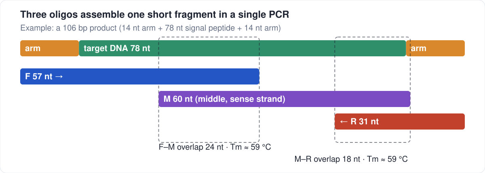

# Short-DNA oligo assembler

**Need a short piece of DNA (up to ~130 bp) and don't want to pay gene-synthesis prices? Order three ordinary oligos instead, and let one PCR join them.**
**想合成一段较短的 DNA（约 130 bp 以内），又不想付基因合成的价格？订 3 条普通寡核苷酸，一次 PCR 拼起来。**

This tool designs the three oligos for you, **checks its own answer** with an independent PCR simulation, and exports an order sheet.
It is one static web page: no install, no server, **your sequences never leave your browser**.

> **[▶ Open the tool](https://qmmyz.github.io/oligo-assembly-designer/)** · or download `index.html` and open it locally.
> The interface is in Chinese; this README explains everything you need (English UI: not yet).


## What it is good for

Short, defined sequences that gene-synthesis services charge a lot for: signal peptides, linkers and tags, short promoters/RBS/terminators, and similar. Oligos are priced per nucleotide; a 106-bp fragment needs three oligos of about 150 nt in total (compare your own vendor's prices).

It was built for cloning nine signal peptides with homology arms (recombination cloning), but the arms are optional, so it works for any short DNA.

## How it works



Two primers of ≤60 nt can only overlap by a few bases on a ~100 bp fragment, which is too short for a 60 °C anneal. A third oligo **M** in the middle gives two overlaps of 18–45 nt instead. For a **single PCR with one annealing temperature (59–61 °C)** the tool picks overlaps whose Tm falls in that window, keeps every oligo ≤60 nt, and prefers G/C at 3′ ends and no primer-dimer-prone ends.

- **F** = (upstream arm +) 5′ part of your sequence · **M** = middle, sense strand · **R** = reverse complement of the 3′ part (+ downstream arm).
- PCR: F and R at ~0.4 µM, M at ~0.02 µM, no template; the page shows a starting program for Vazyme P526 / Phanta UniFi.

## Quick start

1. Open the page. It loads a 9-sequence example and designs it immediately.
2. Replace the text with your sequences, one per line: `name  DNA` (or paste FASTA).
3. **Homology arms:** put yours in the two arm boxes, or clear both if you just need the bare DNA. If your sequence is a protein-coding gene keep *coding sequence* ticked (checks ATG, reading frame, internal stops); untick it for non-coding DNA.
4. Click **设计并验证** (design and verify). Each design shows a map, the three oligos, warnings, and 验证明细 (the check list). **下载 CSV / 复制** gives the order sheet.

Typical limit: product (including arms) up to about **130 bp** works reliably; at 140 bp only some sequences have a solution (random-sequence test: 30/30 designs up to 130 bp, 9/30 at 140 bp). Longer needs a different strategy.

## How the answer is checked

The checker looks only at the final three oligos, simulates PCR (any 3′ end of ≥12 nt that pairs with another strand is extended), and requires that:

- the full product and its complement are formed, and **nothing else** is (no mispriming products among the three oligos);
- the product is exactly *arm + your sequence + arm*, and F/R start the right strands;
- for coding sequences: ATG start, frame, no internal stop, expected amino acids.

`tests/` contains 31 tests: an independent Python re-implementation of the Tm and PCR simulation, plus **mutation tests** (substituted/deleted bases, swapped F/R, broken overlaps, wrong arms) that confirm the checker rejects bad oligos, for the signal-peptide set and for random non-coding DNA of 60–130 bp.

## Please read: what this does not do

- **In-silico only.** The design has not been wet-lab tested yet. The single 60 °C anneal, the M amount and the cycle number are principled starting points, not validated protocol.
- **Sequence-verify your clone.** Oligos are synthesized with errors; PCR assembly has no proofreading step for them. Clone the product and sequence it before you rely on it.
- **No vector checks.** Reading frame across the vector junction and primer mispriming on the vector are not checked.
- **Tm is an empirical fit.** It is SantaLucia-1998 nearest-neighbour with parameters fitted to 8 SnapGene readings (all within ±0.9 °C); it is not SnapGene's published algorithm, and the polymerase vendor's own Tm scale was not reconciled. Details: [docs/design-notes.md](docs/design-notes.md).

## For developers

`window.SPDesigner = {design, verify, tm, …}` is exposed for scripting. Tests open `index.html` in headless Chromium:

```bash
pip install -r requirements-dev.txt
playwright install chromium
python -m pytest -q tests
```

`data/` holds the nine signal-peptide sequences used as golden test input (and as the page's example); provenance and hashes are in `data/MANIFEST.md`.

## Attribution and license

Nearest-neighbour parameters: SantaLucia, J. (1998) *PNAS* 95:1460–1465. The 60 °C single-anneal rule follows the Vazyme Phanta UniFi master-mix manual (P516/P526 family). MIT licensed, see [LICENSE](LICENSE).
