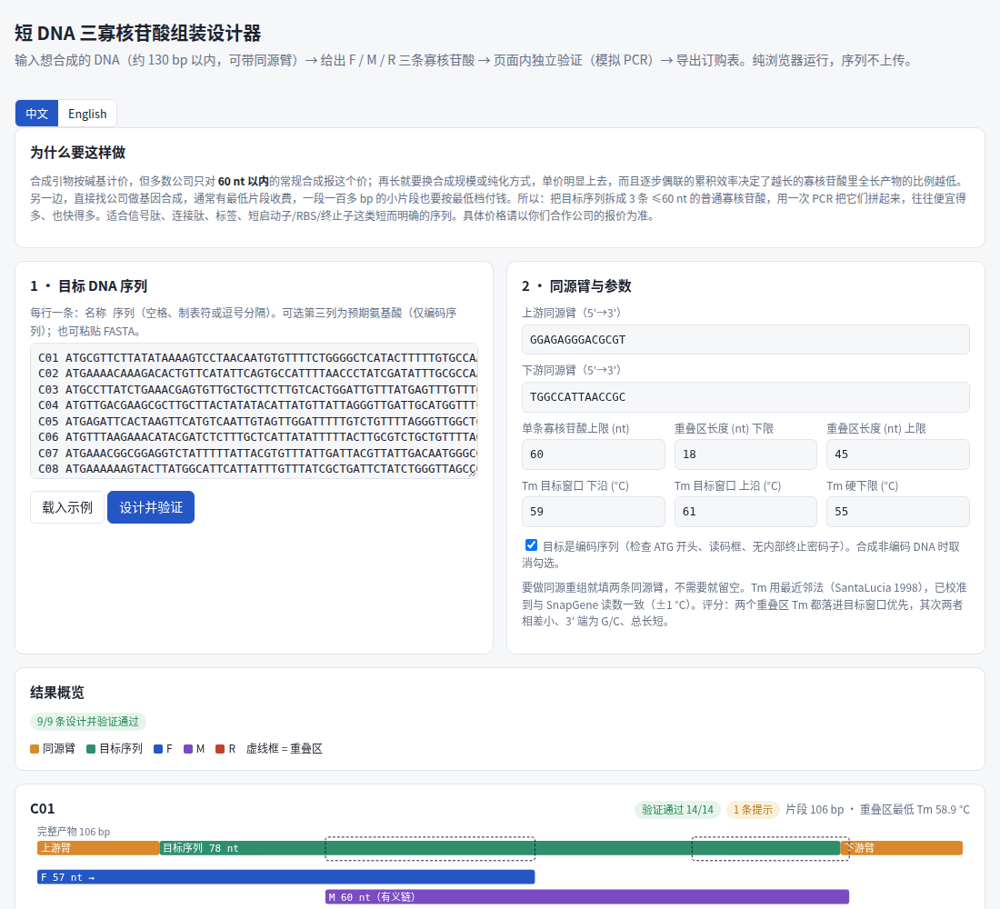
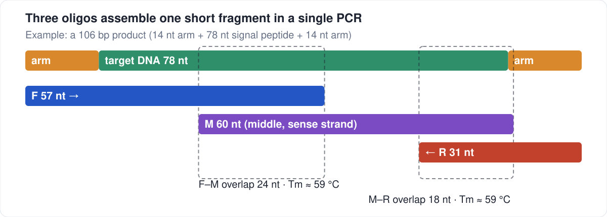

# 短 DNA 三寡核苷酸组装设计器

*[English](README.md)*

**想合成一段较短的 DNA（约 130 bp 以内），又不想付基因合成的价格？订 3 条普通寡核苷酸，一次 PCR 拼起来。**

这个工具替你设计这 3 条寡核苷酸，并用一套独立的模拟 PCR **自己检查答案**，最后导出订购表。它只是一个静态网页——不用安装、不用服务器、**序列不会离开你的浏览器**——界面有中英两种语言。

> **[▶ 打开工具](https://qmmyz.github.io/oligo-assembly-designer/)** · 也可以下载 `index.html` 在本地打开。



## 为什么要这样做

合成引物按碱基计价，但多数公司只对 **60 nt 以内**报这个价。再长就要换合成规模或纯化方式，单价明显上去；而且逐步偶联的效率是累乘的，寡核苷酸越长，里面全长产物的比例越低。另一边，直接找公司做基因合成，通常有最低片段收费，一段一百多 bp 的小片段，付的钱和大得多的片段差不多。

把目标序列拆成 **3 条 ≤60 nt 的普通寡核苷酸，用一次 PCR 拼起来**，往往便宜得多、也快得多。适合信号肽、连接肽、标签、短启动子/RBS/终止子这类短而明确的序列。具体省多少请对照你们合作公司的报价——数字各家不同，但价格随长度上涨的趋势通常一致。

## 原理



对一段约 100 bp 的片段来说，两条 ≤60 nt 的引物之间只剩几个碱基的重叠，撑不住 60 °C 退火。在中间加第三条 **M**，就能得到两段 18–45 nt 的重叠。为了让**一次 PCR、只设一个退火温度（59–61 °C）**就能跑通，工具会挑 Tm 落在这个窗口里的重叠区，保证每条都 ≤60 nt，并尽量让 3′ 端是 G/C、避开容易形成二聚体的末端。

- **F** = （上游同源臂 +）序列的 5′ 段 · **M** = 中间段，有义链 · **R** = 3′ 段的反向互补（+ 下游同源臂）。
- PCR：F 和 R 各约 0.4 µM，M 约 0.02 µM，不加模板，用任意高保真预混液。页面会给出起始体系和程序。

## 快速上手

1. 打开页面，它会载入一个 9 条序列的示例并立即设计。
2. 把文本换成你自己的序列，每行一条：`名称  DNA`（也可以粘贴 FASTA）。
3. **同源臂：** 要做同源重组就把两条臂填进去；只需要裸 DNA 就把两个框清空。插入片段是编码序列时保持勾选"目标是编码序列"（检查 ATG、读码框、内部终止密码子），非编码 DNA 则取消勾选。
4. 点**设计并验证**。每条结果会给出示意图、三条寡核苷酸、提示和完整的检查清单。**下载 CSV / 复制**可以拿到订购表。

长度上限：产物（含同源臂）约 **130 bp** 以内都能稳定设计出来；到 140 bp 时只有部分序列有解（随机序列测试：130 bp 以内 30/30，140 bp 为 9/30）。再长就需要别的策略了。

## 结果是怎么检查的

检查器只看最终那三条寡核苷酸，模拟 PCR（任何 3′ 端只要有 ≥12 nt 能与另一条链配对就延伸），并要求：

- 能形成完整产物及其互补链，而且**不形成别的东西**（三条之间没有错配产物）；
- 产物恰好是 *同源臂 + 你的序列 + 同源臂*，且 F、R 分别是两条链的起点；
- 编码序列还要检查：ATG 开头、读码框、无内部终止密码子、翻译结果与预期氨基酸一致。

`tests/` 里有 32 项测试：用 Python 独立重写了一遍 Tm 和模拟 PCR 来交叉核对，另有**变异测试**（替换/删除碱基、F 与 R 互换、重叠断开、同源臂写错），确认检查器会拦下错误的设计——信号肽那组和 60–130 bp 的随机非编码序列都测。

## 请注意：它没有做的事

- **只做了计算机验证。** 这套设计还没有湿实验验证。60 °C 单一退火、M 的用量和循环数都是按原理给的起点，不是验证过的方案。第一次做建议跑梯度。
- **克隆后要测序。** 寡核苷酸合成本身有错误率，PCR 组装不会纠正它们。拿去用之前先克隆、测序确认。
- **不检查载体。** 跨载体接头处的读码框、引物在载体上的错配位点，都没有检查。
- **Tm 是校准值，不是权威值。** 用最近邻法（SantaLucia 1998），调到与 SnapGene 读数相差约 1 °C 以内。如果你自己的工具算出来不一样，以梯度 PCR 的结果为准。详见 [docs/design-notes.md](docs/design-notes.md)。

## 开发者

页面暴露了 `window.SPDesigner = {design, verify, tm, setLang, …}` 供脚本调用。测试用无头 Chromium 打开 `index.html`：

```bash
pip install -r requirements-dev.txt
playwright install chromium
python -m pytest -q tests
```

`data/` 里是作为金标准测试输入（同时也是页面示例）的 9 条信号肽序列，来源和哈希记在 `data/MANIFEST.md`。

## 出处与许可

最近邻参数：SantaLucia, J. (1998) *PNAS* 95:1460–1465。MIT 许可，见 [LICENSE](LICENSE)。
